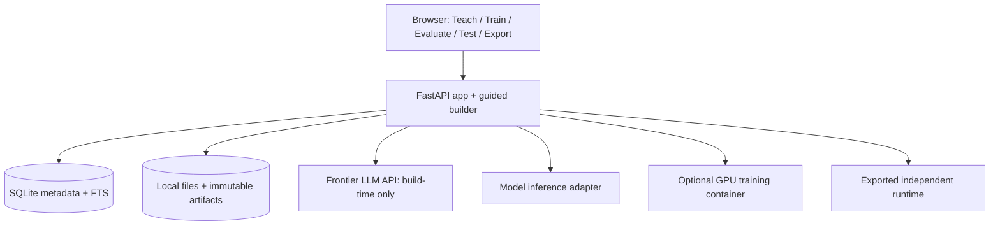

# QuarterMaster — MVP Project Plan

**Status:** Milestones 0–3 implemented; model lifecycle verified as a developer spike; advice/teaching loop pending

**Working name:** QuarterMaster (codename; no public branding or trademark claim)  
**Target:** a focused, self-hosted MVP built in approximately 2–3 weeks of part-time work  
**Companion documents:** [TODO.md](TODO.md), [README.md](README.md), [AGENTS.md](AGENTS.md)

## 1. Overview

QuarterMaster is a **no-code factory for specialized AI advisers**. A small-business owner describes a recurring decision, uploads relevant spreadsheets and Markdown knowledge, teaches the adviser by example, evaluates its judgment, periodically fine-tunes a small open-weight language model, and exports a self-contained adviser that can run independently of the builder.

The product is not a general chatbot, an AutoML workbench, an autonomous agent, or a replacement for KitchenSoup. It does not act on the owner's behalf. It **advises**, explains its recommendation using identifiable evidence, asks for missing information when needed, and can say it does not know.

The core hypothesis is that a domain expert can improve a specialized model through ordinary feedback: **“In this situation, you should have asked for the menu picture.”** The system captures that as a reusable lesson, applies it immediately as context, and later consolidates reviewed examples through supervised fine-tuning (SFT/LoRA).

The MVP demonstrates the complete **teach → test → correct → evaluate → fine-tune → export** loop on at least two unrelated domains using the same code and schemas.

## 2. Product principles

1. **The user teaches judgment, not hyperparameters.** Explain actions in business language. Put model settings under Advanced.
2. **Generic workflow, deliberately limited machinery.** Support any describable domain using a common `Case` and `Advice` contract, but initially accept only supported file types, text-oriented recommendations, and one curated base-model family.
3. **Business usefulness over benchmark theater.** Ask what the owner is trying to improve. Compare with a simple baseline, expose errors and uncertainty, and never call owner approval causal business lift.
4. **Two learning speeds.** Context/lessons can change immediately; weight changes happen in explicit, reviewable training jobs.
5. **Separate knowledge from experience.** Documents supply facts/rules; reviewed case examples teach behavior. Never silently present AI-generated examples as historical truth.
6. **User approval is not a factual label.** Record preference, independent ground truth (when available), and later business outcomes separately.
7. **Explanations are supported narratives, not recovered hidden thoughts.** Cite source snippets, observed case facts, and explicit guidelines. Do not claim to expose the model's actual internal reasoning.
8. **Everything previewable.** Show normalized data, selected training examples, proposed lessons, splits, evaluation cases, and the exported package's contents before expensive work.
9. **Small, stand-alone control plane.** Prefer a Python web app, SQLite, local files, and a few bounded subprocess/container integrations. Avoid building an ML platform.
10. **Immutable versions.** Training inputs, evaluation suites, model outputs, and exports have immutable manifests and content hashes. Corrections create new records, not rewritten history.
11. **No business-side autonomy.** No email sending, posting, payments, scheduling, customer-service actions, or general agent tools. Asking the user for evidence is permitted.
12. **Fail honestly.** If the owner lacks examples, available-at-decision features, or credible outcome evidence, explain the limitation and still allow a knowledge-grounded prototype when safe.

## 3. Target user and success criteria

### Primary user

A small-business owner with practical expertise, spreadsheets, research notes, and little ML experience. Installation is `docker compose up`; configuration requires at most a frontier-model API key for guided building and a local/accessible GPU when training is requested.

### Core user story

1. Install QuarterMaster and open its local UI.
2. State the advisory responsibility: “Help me decide when to publish social media posts.”
3. Upload spreadsheets of past cases and Markdown knowledge.
4. Answer concise questions about objectives, available information, and choices.
5. Ask the untrained, context-grounded apprentice a real question.
6. Say what was wrong with its response and what should happen instead.
7. See the new lesson applied immediately; collect/review further examples.
8. Train a small model, compare it to its predecessor on saved cases, and keep or reject the result.
9. Export a Docker-ready package with a simple advice UI/API.

### MVP success is not

- High generic benchmark accuracy.
- A flattering evaluation score produced solely by an LLM judge.
- Making the owner agree with every response.
- Autonomous improvement or execution of business actions.

### MVP success is

- A nontechnical tester can create two advisers without changing code.
- A correction such as “ask for the image first” visibly improves the next similar interaction via context.
- Reviewed corrections can become a LoRA training dataset without the owner writing JSONL.
- Fine-tuned and unmodified models can be compared on the **same held-out cases**.
- A selected adviser can run from its exported package without QuarterMaster or a frontier-model API.
- The system reports when it lacks evidence, and can preserve a previous model if training regresses.

## 4. MVP scope

### Included

- Self-hosted, trusted **single-user** web application, default loopback exposure.
- Teach, Train, Evaluate, Test, and Export screens; plain-language onboarding in Teach.
- CSV, XLSX, and Markdown upload. Multiple sheets/files, column previews, and user-confirmed joins only.
- Original file retention, size limits, fingerprints, validation, and provenance.
- Guided problem-definition interview through a configurable OpenAI-compatible provider.
- Clear distinction between historical observations, reviewed examples, policies/research, and synthetic suggestions.
- Canonical text/JSON case representation for structured and unstructured inputs.
- Simple document retrieval using local chunks and SQLite full-text search; sources are cited.
- Immediate correction-to-lesson workflow and structured feedback taxonomy.
- A base-model/context-only apprentice before training.
- Explicit review of generated SFT pairs; small curated Qwen model and LoRA training on a supported local GPU.
- Pinned, immutable model versions; short evaluation suites; side-by-side comparison.
- Standard exported Docker Compose runtime containing model, retrieval material, adviser configuration, and a minimal advice UI/API.
- Predictable local developer workflows and meaningful unit/integration/smoke tests.

### Explicitly excluded from MVP

- LightGBM, AutoML, automatic feature-search or arbitrary predictive pipeline generation.
- Automatic web research, crawling or external business-tool calls.
- Action execution, orchestration of third-party agents, workflow automation, scheduling.
- Continuous self-improvement, automatic promotion, reinforcement learning, online learning.
- Multi-tenant hosting, RBAC, SSO, billing, enterprise governance.
- Distributed queues, Kubernetes, managed GPU platforms, autoscaling, remote SSH orchestration.
- Arbitrary base-model selection, multimodal fine-tuning, image ingestion/vision advice.
- General causal attribution, off-policy evaluation, full feature stores, drift-alert infrastructure.
- Automatically asserting numerical outcome probabilities without calibration/evaluation evidence.
- Guaranteed fine-tuning on CPU-only hardware, or guaranteed ability to train from unlabeled spreadsheets alone.

### Supported problem envelope

MVP cases contain a natural-language/JSON **situation**, optional alternatives, and an expected **advisory behavior** (recommend, qualify, request missing evidence, or abstain). This is domain-generic but not mathematically universal. Numerical inputs and optional numerical estimates are supported as context/output; reliable regression or causal action-effect estimates are **not** promised. The builder asks for human examples or reviews proposed examples when uploaded history does not directly contain target advice.

## 5. First-contact experience

The first screen asks: **“What would you like your adviser to help you decide?”**

For a social-media use case, the builder asks what “success” means (reach vs clicks vs sales), what can actually be controlled (posting time vs content), and which facts are available before publishing. It previews uploaded posts and research, then offers a context-grounded first answer **before any training run**.

The owner responds: “For a product announcement, first ask if it's coordinated with an email campaign.” QuarterMaster proposes a precise generalizable lesson, shows the originating case, and requests confirmation. The lesson is immediately retrievable. It may later become a reviewed fine-tuning pair.

The visible UI uses five tabs:

| Tab | Minimum contents | Primary action |
| --- | --- | --- |
| **Teach** | Mission, files, source previews, guided questions, case examples, lessons | Give the apprentice knowledge and experience |
| **Train** | Selected examples, base model, data split, hardware check, job progress, resulting version | Consolidate reviewed lessons through LoRA |
| **Evaluate** | Saved cases, human rubric, before/after answers, preferences, regressions | Decide whether a new version is better |
| **Test** | Chat-like situation entry, advice, citations, missing-information questions, structured correction form | Try and challenge the adviser |
| **Export** | Chosen version, disk/CPU/RAM estimate, runtime test, downloadable package | Run the adviser independently |

One project may have multiple lesson revisions, training runs, evaluations, and exports. The default UI shows **one active adviser** and hides lineage details under an expandable section.

## 6. Minimal architecture



### Application

- Python, FastAPI, Jinja2, HTMX, and light client-side JavaScript (Alpine.js optional). No mandatory Node frontend build.
- SQLAlchemy + SQLite (WAL for ordinary reads); versioned schema migrations, or a small deliberate migration layer if simpler.
- Local directory artifact store under a configured data volume. Use atomic writes and SHA-256 checks; no RustFS/S3 in MVP.
- In-process web requests for bounded operations; one persisted, single-concurrency background job runner for long operations. No Redis, Celery or Temporal.
- Startup recovers interrupted job state by marking stale jobs interrupted and allowing explicit retry; never silently repeat a potentially billable training job.

### Provider boundaries

Define small protocols and one supported implementation of each:

- `BuilderLLM`: structured interview, corrections extraction, example drafting; OpenAI-compatible API.
- `DocumentRetriever`: local chunk search with provenance; SQLite FTS5.
- `InferenceEngine`: local small-model generation with constrained JSON validation and retry.
- `TrainingEngine`: versioned container invocation producing a PEFT LoRA adapter, manifest and logs.
- `Exporter`: turns a frozen model version into a tested package.

Avoid generic registries and plugin discovery until a second implementation is actually required.

### Deployment shape

- Builder: one web container and persistent volume. Training uses an optional GPU-enabled worker/container; ordinary Compose starts without GPU.
- Standalone export: one standard prebuilt runtime image + a project-specific model/config/knowledge bundle, bootstrapped by a generated `compose.yaml`.
- The exported adviser defaults to loopback binding. It does **not** need the builder, training GPU, owner API key, or external LLM service for core advice.

## 7. Data ownership and canonical concepts

| Concept | Meaning | Mutable? |
| --- | --- | --- |
| `Project` | Advisory mission and currently selected version | Metadata editable |
| `Source` | Original uploaded CSV/XLSX/MD plus provenance/hash | Immutable bytes |
| `KnowledgeRevision` | Approved source set + indexed chunks | Immutable version |
| `Case` | Situation, available context, optionally choices, observed outcomes | Immutable revision |
| `Lesson` | Reviewed natural-language instruction or correction, with source case | Append-only revisions |
| `TrainingExample` | Reviewed input/desired-advice pair with origin | Immutable once frozen |
| `EvaluationSuite` | Frozen cases and rubrics, separate from training | Immutable version |
| `AdviserVersion` | Base revision, lesson set, adapter, data and evaluation pointers | Immutable |
| `TrainingRun` | Snapshot, status, logs, artifacts | Append-only status events |
| `EvaluationRun` | Version-specific output and user ratings | Immutable results + appended ratings |
| `Export` | Verified runtime package linked to exact adviser version | Immutable |

Use UUIDs and timestamps for records, SHA-256 for source/artifact fingerprints. SQLite is canonical for metadata; files are canonical for original and derived bytes. Search indexes are rebuildable projections.

### Minimal `AdviserSpec`

```yaml
schema_version: quartermaster.adviser/v1
id: d82d635b-79b1-46ce-a924-c47b0f8094ea
revision: 1
created_at: 2026-10-24T00:00:00Z
name: Social post adviser
mission: Recommend when to publish a social-media post.
business_goal: Improve post reach without overclaiming causal lift.
decision_definition: null
inputs: quartermaster.case/v1
outputs: quartermaster.advice/v1
model:
  base_model_id: Qwen/Qwen3.5-0.8B
  base_revision: 2fc06364715b967f1860aea9cf38778875588b17
  adapter_artifact: null
knowledge_revision: null
lessons_revision: null
```

The [adviser contract](quartermaster/contracts/adviser.py) implements this configuration with UUIDs, append-only revisions and UTC timestamps. `knowledge_revision` becomes a UUID when the owner selects Markdown sources. Milestone 3 adds an optional, backward-compatible `decision_definition`: owner-reviewed available choices, target behavior, case grain, decision inputs and success/harm observation. It stays null for projects without an applied interview. Interview answers and AI drafts remain separate append-only records until explicit review; they create no training labels. Adapters and lessons remain null until their respective product milestones; unknown model/contract semantics are rejected. The text-only model lifecycle is tested in the [Milestone 1 record](docs/milestone-1.md); the product inference/runtime remains later work. Avoid asking the model for an uncalibrated `confidence: 0.93` field.

### Minimal case and feedback

```json
{
  "case_id": "case-123",
  "situation": {"kind": "product_announcement", "proposed_day": "Friday"},
  "knowledge_revision": "kb-7",
  "decision_at": null,
  "source_refs": ["posts.csv:row-37"],
  "observed_outcome": null
}
```

```json
{
  "case_id": "case-123",
  "feedback_type": "should_ask_question",
  "owner_comment": "First ask whether there is a coordinated email campaign.",
  "proposed_lesson": "For product announcements, ask about coordinated campaigns before advising.",
  "review_state": "pending"
}
```

The system must not treat arbitrary natural-language feedback as trusted until the owner approves the extracted meaning. Preserve raw correction text alongside the structured proposal.

## 8. Ingestion and data understanding

1. Accept `.csv`, `.xlsx`, `.md` (optionally `.txt` after the basic path is stable). Do not execute macros, formula code, uploaded Python or archive scripts.
2. Store original uploads unchanged, with sanitized display names, hashes and upload limits.
3. Inspect spreadsheet sheets, columns, types, row counts, missing values, date candidates, sample rows. Never infer joins silently.
4. Classify each source with owner confirmation: **observations**, **reviewed examples**, or **knowledge/research**. Spreadsheet cells are untrusted text.
5. Ask which columns existed at decision time and which are outcomes recorded afterward. Warn about leakage; don't use post-decision outcomes inside model input.
6. Serialize each case into stable structured text/JSON and keep source field mappings. Choose a case grain (one row, post, invoice, incident, etc.).
7. Do not pretend that historical outcomes define ideal human advice. If history lacks owner-approved target behavior, propose synthetic candidate examples labeled **AI draft** for review; otherwise enter a knowledge-only prototype state.
8. Split real historical examples by entity/time before drafting examples or computing eval results; prevent duplicate/near-duplicate cases crossing train and evaluation sets.
9. Markdown supplies reference context and policies. Index headings and chunks with source, location and content hash; for the MVP use FTS5 lexical retrieval with a source link.

The builder can interview the user about available choices and goals. It should not generate arbitrary executable preprocessing code. Support a deliberately small set of deterministic column-to-case mappings with user confirmation.

Milestone 2 implements this manual foundation ([guide](docs/milestone-2.md)). A reviewed mapping creates `quartermaster.derived-case/v1` records wrapping the existing text `Case`, with mapping ID, source hashes, sheet/row and physical CSV line positions. The situation is canonical JSON text containing only selected decision inputs. Observed outcomes and unreviewed target candidates remain separate; no supervision is approved by importing a file. Exact, explicitly keyed many-to-one joins preserve one case per primary row and reject missing or ambiguous matches. Knowledge revisions select Markdown source IDs; lexical retrieval and citation lookup use only the requested revision, defaulting to the current one.

## 9. Apprentice behavior and two-speed learning

### Runtime advice contract

Given a case, relevant authorized knowledge snippets, approved lessons and a model version, produce **one** JSON-compatible response containing:

- `recommendation`: best current advice or explicit inability to advise;
- `explanation`: concise, plain-language basis for the recommendation;
- `evidence_refs`: zero or more source identifiers that genuinely support claims;
- `clarification_question`: if evidence is missing, ask instead of forcing a guess;
- `limitations`: relevant uncertainty, unsupported comparisons, unknowns.

Validate the schema. Verify citations refer to retrieved material; reject or remove nonexistent citations. Never advertise a free-form model explanation as a faithful reading of hidden reasoning. Ask-first behavior is part of the output contract, not a tool call.

### Immediate learning (lesson/context)

The owner chooses a feedback type:

1. Good advice.
2. Wrong recommendation.
3. Missed knowledge/context.
4. Should have asked a question.
5. Unsupported or misleading explanation.

The builder converts the comment into a proposed lesson, with applicability and source case, for explicit owner review. Once approved, it is stored as a new lesson revision and injected/retrieved in subsequent responses. This changes **context**, not weights; the UI must say so.

### Consolidated learning (LoRA)

- Owner may promote reviewed before/after pairs into supervised training examples.
- A training job freezes the base model revision, approved examples, knowledge/lesson revisions, train/eval split and training recipe.
- Train a PEFT LoRA adapter on the text backbone of pinned `Qwen/Qwen3.5-0.8B`. The [Milestone 1 spike](docs/milestone-1.md) records the tested revision, LoRA merge/GGUF path and hardware limits; it does not establish adviser quality or approve a candidate for active use.
- Training may run only after hardware and dataset validation. Show rough job time and that a compatible NVIDIA GPU is required in the initial implementation.
- Preserve the base model and previous successful adapter. A new version is a **candidate** until the owner evaluates/selects it.
- A correction is not automatically proof that the owner's preferred advice improves business outcomes; retain independent observed outcomes when provided.

## 10. Evaluation and business usefulness

### Baselines

Compare at least:

1. Base model with no custom context (when meaningful).
2. Base model with the current knowledge/lessons.
3. Fine-tuned model with the **same** knowledge/lessons.

Keep retrieval/instructions constant for before/after comparison; otherwise the apparent training lift is confounded by changed context.

### Evaluation suites

- Owner creates/saves at least 5–10 representative test situations before training, including hard/missing-information cases.
- Freeze the test suite version and keep it out of training, synthetic generation, and example-selection prompts.
- Record per-case response, citations, clarification behavior, rubric, model version, inference parameters and timestamp.
- Owner can mark **better / worse / same**, categorize errors and enter free-text corrections.
- Automated deterministic checks: JSON validity, requested clarification where specified, refusal behavior, citation existence and adherence to explicit hard rules.
- An LLM judge may **suggest** a rating, but its rating is never presented as ground truth. Human evaluation remains visible.
- Do not combine all signals into an opaque one-number quality score. Display counts, cases improved/regressed, and examples side by side.
- Track optional business outcome separately from owner preference. A 30-day observed conversion is not attributable to the adviser without a suitable comparison design.

### Promotion gate

No automatic promotion. Show a diff of significant wins and regressions, warn on untested slices, then let the owner choose the active version. If the new candidate fails core held-out cases, default to keeping the existing adviser.

## 11. Training engine and practical hardware

The app orchestrates but does not implement a model architecture. The training container owns dependencies such as Transformers, TRL, PEFT, and Accelerate. App and trainer communicate using a **versioned file-based job spec and artifact manifest**; no import of trainer private Python internals.

Training flow:

1. Validate data sufficiency and show exact reviewed examples.
2. Snapshot examples and hold-out identifiers; freeze seed and training recipe.
3. Start a single-concurrency local Docker training job with explicit GPU access, timeout, disk and memory guardrails.
4. Stream bounded status/logs without prompts, customer data or secrets.
5. Verify adapter files and manifest hashes before registering a candidate version.
6. Run a small sanity inference, then evaluate on frozen cases.
7. Keep original examples, recipe, base revision, engine/image digest and reproducibility metadata.

Only one curated model family and a small preset selection (`quick`, `standard`) are in scope. No arbitrary hyperparameter sweeps. GPU training must be opt-in; the web UI and base-model/context exploration should run without it (CPU inference may be slow). If the required GPU is unavailable, clearly explain the blocker rather than silently initiating a cloud job.

## 12. Export and independent runtime

**Hard requirement:** the exported adviser must function without QuarterMaster and without the build-time frontier-model provider.

Package layout, conceptually:

```text
my-adviser/
  compose.yaml
  README.md
  adviser.yaml
  model/
    model.gguf
  knowledge/
    chunks.jsonl
    index.sqlite
  manifests/
    export.json
```

The builder uses one versioned **standard runtime image**; it does not generate a new application codebase per customer. The runtime hosts a small local inference engine (candidate: llama.cpp), a simple chat/structured-case UI, and `POST /v1/advise`, `GET /healthz` endpoints. It applies the frozen configuration, lessons and retrieval policy.

Export steps:

1. Resolve exact model/adviser revision, source hashes and base-model license.
2. Merge LoRA and convert/quantize to a supported GGUF target, **only after an early verified compatibility spike**; an alternative direct-adapter export is acceptable only if proven end to end.
3. Build offline retrieval material from the selected knowledge revision; do not export source documents omitted from the selected revision.
4. Write the packaged manifest, `compose.yaml`, required runtime image reference and operator instructions.
5. Smoke-test a freshly extracted export from a separate working directory; compare response schema and citations to the builder's selected version.
6. Present approximate hardware, runtime size and disk needs, then offer download.

“Standalone” means independent execution **after** the appropriate runtime image and model artifact have been obtained. The install may require an initial image pull; routine advice cannot depend on QuarterMaster's database, its API token, or an online LLM. It will be slower on CPU than on suitable GPUs. Offline image-bundle distribution itself is deferred.

## 13. Security and privacy baseline

- Explicitly trusted **local single-user** deployment; bind ports to `127.0.0.1` by default. Document that internet exposure needs an external secure reverse proxy and authentication not included in MVP.
- API keys supplied via environment/secret file, never persisted in model packages or logs.
- Before any upload content is sent to a frontier API, disclose the provider and require a clear user opt-in. Allow local/manual operation where feasible.
- Treat spreadsheet cells, Markdown, retrieved documents and model replies as untrusted input. They cannot instruct QuarterMaster to execute arbitrary commands or expand permissions.
- No arbitrary generated code execution in the builder. Fixed recipes only, with validated parameters.
- Bound file count/size, token and prompt budgets, job time, GPU concurrency and disk usage.
- Guard against path traversal, document-based prompt injection, spreadsheet formula injection in exports and ZIP extraction attacks.
- Deleting a project requires confirmation; preserve active immutable artifacts until no references remain. Document backup of the persistent volume.
- Never claim compliance or complete prevention of data leakage; the MVP is not a hardened multi-tenant service.

## 14. Suggested repository structure

```text
QuarterMaster/
  AGENTS.md
  PLAN.md
  TODO.md
  README.md
  pyproject.toml
  Makefile
  compose.yaml
  .env.example
  quartermaster/
    api/              # FastAPI routes
    ui/               # Jinja templates / static assets
    config.py
    db/               # SQLite models and migrations
    projects/
    ingestion/
    interviews/
    knowledge/
    cases/
    lessons/
    evals/
    inference/
    training/         # orchestration and versioned spec
    export/
    contracts/        # Pydantic schemas
  trainer/             # independently built optional GPU image
  runtime/             # standard self-contained adviser container
  tests/
    fixtures/
    unit/
    integration/
    smoke/
  docs/                # add only when needed
```

Create directories on demand; this tree is a target, not an instruction to scaffold empty modules.

## 15. Developer contract

Expected Make targets once implemented:

| Target | Purpose |
| --- | --- |
| `make help` | Discover development commands |
| `make setup` | Install local development dependencies |
| `make fmt` | Format files |
| `make lint` | Lint/type-check lightweight code |
| `make test` | CPU-only unit and integration fixtures |
| `make up` / `make down` | Start/stop builder Compose without GPU |
| `make logs` | Follow application logs |
| `make migrate` | Apply SQLite schema migrations |
| `make test-gpu` | Opt-in LoRA smoke test (never in normal CI) |
| `make test-export` | Smoke-test generated adviser package |

Pin container images, base-model revision and package dependencies for reproducible build paths; defer elaborate build/release infrastructure until the MVP is functional.

## 16. Testing strategy

### Unit (CPU, deterministic)

- CSV/XLSX/MD parsing, source classification, deduplication, cell/filename escaping and content hashes.
- Canonical `Case`, `Lesson`, `AdviserSpec`, `Advice` validation and schema version compatibility.
- Safe review-state transitions, promotion and frozen eval suite semantics.
- Point-in-time feature availability checks where time fields are provided.
- Citation validation, lexical retrieval boundaries and source retractions.
- Training-job spec validation, artifact manifest checks and failure/restart state transitions.
- Export packaging, path validation and reproducibility fingerprints.

### Integration (CPU, mocked API)

- End-to-end mission → upload → interview → context answer → correction → approved lesson → improved answer with deterministic fake-model responses.
- Test feedback categories, review requirement, evaluation freeze and comparison.
- API timeout/malformed JSON/error visibility; no secret logging.
- Delete/restart/backups and persistent-volume behavior.

### Opt-in model/GPU smoke

- Pinned small Qwen text inference and LoRA training on a tiny reviewed synthetic corpus.
- Before/after output comparison using a frozen eval fixture.
- Merge/convert/quantize, launch separate runtime, send API request, verify response and cited knowledge.
- Verify GPU/disk prerequisites and job cancellation/timeout recovery.

No model-quality claim is supported merely by mocked tests. Record actual hardware, base revision and inference engine versions when live GPU validation is performed.

## 17. Highest-risk assumptions: test first

1. **Model lifecycle:** can a selected small Qwen release be fine-tuned, exported to a portable runtime format and reloaded reliably? Run this spike before polishing the UI.
2. **Teaching quality:** does a natural-language correction become a useful *general* lesson, not just rote repetition of one sample? Test on a near-neighbor case not seen during correction.
3. **Data adequacy:** can realistic owner spreadsheets be converted into reviewed cases without silently inventing supervision? Show a visible “not enough examples yet” path.
4. **Evaluation validity:** can the owner distinguish preferred response style from truth/outcome? Keep separate fields and a locked suite.
5. **Inference practicality:** can exported 0.8B-class advice run on an ordinary CPU with tolerable latency and meaningful limitations? Measure, don't promise.
6. **KB fidelity:** do cited sources actually support the answer, including when documents disagree? Test conflicts and omitted sources.

## 18. Implementation sequence and timebox

The milestone IDs in [TODO.md](TODO.md) are stable. Within each milestone, finish the acceptance criteria before expanding scope.

### Week 1 — Prove the model/product seam

- **M0: Bootstrap.** FastAPI/Jinja skeleton, local persistence, Compose, test commands.
- **M1: Vertical technical spike.** Frozen toy training examples → pinned Qwen LoRA → quantized portable inference → a Docker runtime response. If this fails, adjust the model/runtime choice before UI investment.
- **M2: Teach foundations.** Project, upload, parsing, knowledge chunks, basic case builder.

### Week 2 — Make it teachable

- **M3: Guided interview.** Project definition and source-to-case mapping, mocked provider tests.
- **M4: Test & immediate lessons.** Baseline adviser, retrieval, evidence display and corrections; owner-approved context improvements.
- **M5: Evaluation.** Frozen cases, comparative displays, regression detection and manual scores.

### Week 3 — Consolidate and ship

- **M6: Real training workflow.** Reviewed example generation, job progress, saved model candidate, pre/post evaluation.
- **M7: Export.** Independent runtime packaging, local API/UI, verified new-directory startup.
- **M8: Polish.** Error copy, CPU-only fallback UX, demo, docs, safety and release checks.

This is an aggressive **target**, not an engineering guarantee. Prefer a smaller working loop to partially implementing all milestones. If necessary, ship a working correction/context MVP first, but **do not label it the fine-tuned standalone MVP** until M6–M7 pass.

## 19. Release gate (MVP 0.1.0)

An end-to-end demo on a clean Docker Compose install must show:

1. A business owner creates a project from a plain-language mission.
2. Uploads a spreadsheet and at least one Markdown file and sees accurate previews.
3. Confirms case mapping, available-at-decision inputs, and business objective.
4. Gets a grounded initial advisory answer or a precise request for missing information.
5. Corrects a bad response; reviews the proposed lesson; tests a similar, unseen case and sees changed context behavior.
6. Creates and freezes evaluation cases **before** training.
7. Promotes reviewed examples into an SFT dataset and runs a small LoRA job on supported GPU hardware.
8. Compares candidate and baseline with retrieval/context held constant, including visible regressions.
9. Selects a version and exports a package.
10. Starts the exported adviser **without the builder**, calls `POST /v1/advise`, inspects evidence and verifies no frontier-model API is used.
11. Repeats the project flow for a **second unrelated domain** without editing application code.

Demo fixtures should include both (a) social-post timing with numerical observations and research notes and (b) a decision scenario requiring a clarification question. Synthetic fixtures must be plainly labeled; report owner preference and observed business results separately.

## 20. Future extension seams (not a mandate)

- **Learning:** automated lesson clustering, offline improvement proposals, retrieval-vs-LoRA routing, active example selection, calibrated typed decision heads (Jev/Kev-style), preference training.
- **Data:** optional embedding search, additional file types, image/document OCR, semantic feature extraction, stronger temporal feature contracts.
- **Evaluation:** blinded comparisons, representative domain suites, delayed outcome logging, controlled experiments and causal estimators where identifiable.
- **Infrastructure:** remote GPU executor, provider billing/budgets, multiple users and RBAC, deployment registry, drift monitoring.
- **Models:** other open-weight families, model selection, local builder, stronger multimodal support.
- **Advising:** constrained external read-only research tools, but **no action execution** without a new product/safety decision.

These must be motivated by observed business-user friction or quality outcomes, not architecture aesthetics. Do not pre-build abstractions for them.
